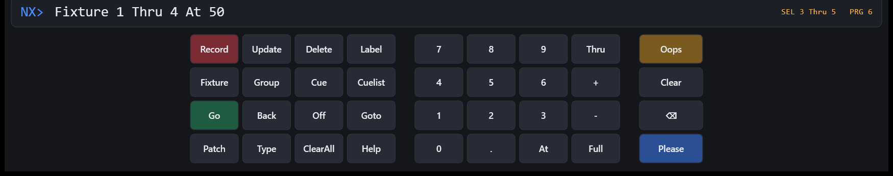
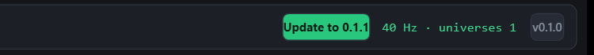

<div align="center">


# NX-DMX

**Lichtpult-Software für Windows mit Art-Net-Ausgabe, bedient über eine Befehlszeile wie bei grandMA und ONYX.**

[](https://github.com/nexoGroups/NX-DMX/actions/workflows/ci.yml)
[](https://github.com/nexoGroups/NX-DMX/releases/latest)
[](LICENSE)


[**Download**](https://github.com/nexoGroups/NX-DMX/releases/latest/download/NxDmx-win-Setup.exe) ·
[Schnellstart](#schnellstart) ·
[Befehle](#befehle) ·
[Art-Net einrichten](#art-net-einrichten) ·
[Roadmap](#roadmap)


</div>

---

## Was ist NX-DMX?

NX-DMX ist ein Lichtpult für Theater und Events, das als Windows-Programm läuft und DMX über **Art-Net** an Nodes im
Netzwerk schickt. Statt Fader-Rastern wie bei einfachen DMX-Programmen arbeitest du so, wie man es von grandMA und ONYX
kennt: Du tippst Befehle in eine Befehlszeile (`Fixture 1 Thru 8 At 50 Please`), speicherst mit `Record` und fährst
Cues mit `Go`. Ein Fehler lässt sich jederzeit mit `Oops` zurücknehmen.

> **Stand: frühe Version (0.x).** Die Grundlagen funktionieren und sind getestet, aber es fehlt noch einiges, unter
> anderem Fades und Executor-Fader (siehe [Roadmap](#roadmap)). Die Art-Net-Ausgabe
> wurde bisher gegen einen Test-Empfänger geprüft, noch nicht an echter Hardware. Setze sie vorerst nicht für eine
> Live-Show ein, bei der etwas schiefgehen darf.

### Was schon geht

- **Art-Net 4** (ArtDmx, UDP Port 6454) mit 40 Hz, beliebig viele Universen, wahlweise Broadcast, Unicast an einen Node
  und Auswahl des Netzwerkadapters
- **Befehlszeile und Tastenfeld** im Stil von grandMA2 und ONYX: `Fixture`, `Group`, `At`, `Thru`, `+`, `-`, `Full`,
  `Record`, `Update`, `Delete`, `Label`, `Go`, `Back`, `Goto`, `Off`, `Patch`
- **`Please`** zum Ausführen (am Zeilenende optional) und **`Oops`** zum Rückgängigmachen, mehrfach hintereinander
- **Programmer** mit stufenweisem `Clear` und `ClearAll`
- **Cuelists mit Tracking**, Cue-Nummern mit Nachkommastellen (`Cue 1.5`), mehrere Cuelists gleichzeitig
- **Gruppen**, Fixture-Typen `Dimmer`, `RGB`, `RGBW`, `RGBDim` und `Mover` (Pan/Tilt in 16 Bit)
- **Mischen wie auf dem Pult:** Helligkeit nach HTP, alle anderen Werte nach LTP, der Programmer liegt obenauf
- **Live-Ansicht** von Fixtures, Cuelist, Gruppen, Befehls-Log und dem DMX-Wert jedes Kanals
- **Shows speichern und laden** (`.nxshow`), dazu eine automatische Sicherung nach jeder Änderung
- **Automatische Updates:** Eine neue Version erscheint als grüner Button in der Kopfzeile (siehe [Updates](#updates))

## Installation

1. Lade **[NxDmx-win-Setup.exe](https://github.com/nexoGroups/NX-DMX/releases/latest/download/NxDmx-win-Setup.exe)** von der
   [Release-Seite](https://github.com/nexoGroups/NX-DMX/releases/latest) herunter.
2. Starte die Datei. Es ist keine Admin-Berechtigung nötig, und .NET muss nicht installiert sein. NX-DMX landet im
   Benutzerordner und bekommt eine Verknüpfung auf dem Desktop und im Startmenü.
3. Art-Net-Pakete gehen als ausgehender UDP-Verkehr raus, die Windows-Firewall lässt das normalerweise zu. Blockiert
   eine Sicherheitssoftware ausgehende Pakete, zeigt NX-DMX oben rechts einen Sendefehler an.

**Windows meldet "Der Computer wurde durch Windows geschützt"?** Das Installationsprogramm ist nicht mit einem
Zertifikat signiert, deshalb zeigt SmartScreen diese Warnung. Klicke auf **Weitere Informationen** und dann auf
**Trotzdem ausführen**. Den Quellcode, aus dem die Datei gebaut wird, findest du in diesem Repository, und die
Release-Dateien entstehen vollautomatisch in [GitHub Actions](.github/workflows/release.yml).

Voraussetzung: Windows 10 oder 11, 64 Bit.

## Schnellstart

Beim allerersten Start ist ein Demo-Rig gepatcht (8 RGB-Dimmer-Fixtures, 4 Mover, 4 Dimmer in Universum 1). Danach
startet NX-DMX immer mit der Show der letzten Sitzung. Alle Befehle schreibst
du in die Zeile `NX>` unten und bestätigst mit **Enter** oder der **Please**-Taste. Die Tasten darunter tippen dieselben
Wörter für dich ein.

```text
NX> Fixture 1 Thru 8 At 100        Fixtures 1 bis 8 auswählen und auf 100 % setzen
NX> Red At 100                     Rot auf 100 %
NX> Green At 55                    Grün auf 55 %  (ergibt zusammen ein warmes Licht)
NX> Record Cue 1 "Warm Wash"       Alles, was im Programmer steht, als Cue 1 speichern
NX> Record Group 1 "Front"         Die Auswahl als Gruppe 1 speichern
NX> ClearAll                       Programmer leeren
NX> Group 1                        Gruppe 1 wieder auswählen
NX> Blue At 100                    Fixtures 1 bis 8 blau machen
NX> Record Cue 2 "Blue Night"      Als Cue 2 speichern
NX> Go                             Cue 1 starten, noch einmal Go startet Cue 2
NX> Oops                           Den letzten Programmierschritt zurücknehmen
```

Das Ergebnis siehst du sofort im Fixtures-Panel und im DMX-Monitor rechts unten. Mit `Help` listet die Software alle
Befehle auf.

<div align="center">

</div>

## Befehle

| Befehl | Wirkung |
|---|---|
| `Fixture 1 Thru 10` | Fixtures 1 bis 10 auswählen |
| `Fixture 1 + 5 + 7 Thru 9 - 8` | Mit `+` hinzufügen und mit `-` entfernen |
| `Group 2` | Gruppe 2 auswählen |
| `At 50` oder `At Full` oder `Full` | Helligkeit der Auswahl in Prozent |
| `Red At 100`, `Pan At 25` | Einzelne Attribute: `Red`, `Green`, `Blue`, `White`, `Pan`, `Tilt` |
| `Record Cue 1 "Name"` | Programmer als Cue speichern, optional mit `Cuelist 2` |
| `Record Group 3 "Name"` | Auswahl als Gruppe speichern |
| `Update Cue 1` | Den Programmer in einen bestehenden Cue einfügen |
| `Delete Cue 1`, `Delete Group 3`, `Delete Cuelist 2` | Löschen |
| `Delete Fixture 1 Thru 5` | Fixtures aus dem Patch entfernen |
| `Label Group 3 "Front"` | Umbenennen (auch `Cue` und `Fixture`) |
| `Go`, `Go -`, `Back`, `Goto Cue 5`, `Off` | Playback, mit `Cuelist 2` hinten für eine andere Cuelist |
| `Patch Fixture 1 Thru 8 Type RGBDim At 1.1` | Fixtures anlegen: Typ und Adresse als `Universum.Adresse` |
| `Clear` | Schrittweise zurück: erst Auswahl, dann Programmer |
| `ClearAll` | Auswahl und Programmer auf einmal leeren |
| `Oops` | Letzten Programmierschritt zurücknehmen, bis zu 100 Mal |
| `Please` | Führt die Zeile aus. Am Zeilenende optional, wie bei der grandMA |
| `Help` | Zeigt die Befehlsübersicht |

**Fixture-Typen:** `Dimmer` (1 Kanal), `RGB` (3), `RGBW` (4), `RGBDim` (4, mit Dimmer-Kanal) und `Mover` (8, Pan/Tilt in
16 Bit, Dimmer, RGB). RGB-Fixtures ohne eigenen Dimmer bekommen einen virtuellen Dimmer, der die Farben skaliert.

**Oops und Playback:** `Oops` macht alle Programmierschritte rückgängig (Auswahl, Werte, Record, Delete, Label, Patch).
`Go`, `Back`, `Goto` und `Off` gehören nicht dazu, wie bei der grandMA. Ein fehlgeschlagener Befehl hinterlässt nichts
Halbfertiges.

## Shows speichern und laden

Ein Show besteht aus dem Patch, den Gruppen und den Cuelists mit allen Cues. Die Zeile **SHOW** in der Kopfzeile zeigt
den Namen, und ein oranges **● unsaved** erscheint, solange es ungespeicherte Änderungen gibt.

| Taste | Tastenkürzel | Wirkung |
|---|---|---|
| **New** | `Strg+N` | Leere Show ohne Patch anlegen |
| **Open** | `Strg+O` | Eine `.nxshow`-Datei öffnen |
| **Save** | `Strg+S` | Speichern, beim ersten Mal mit Namensabfrage |
| **Save as** | `Strg+Umschalt+S` | Unter neuem Namen speichern |

- Die Dateien liegen standardmäßig in `Dokumente\NX-DMX Shows` und sind lesbares JSON. Sie lassen sich kopieren, sichern
  und auf einen anderen Rechner mitnehmen.
- **Automatische Sicherung:** Nach jeder Änderung schreibt NX-DMX die aktuelle Show nach `%AppData%\NX-DMX`. Nach einem
  Absturz, einem Stromausfall oder einem Update-Neustart ist sie beim nächsten Start wieder da.
- Vor **New**, **Open** und dem Schließen fragt NX-DMX nach, wenn es ungespeicherte Änderungen gibt.
- Nicht gespeichert werden der Programmer, die Auswahl und die aktuelle Cue-Position der Cuelists. Nach dem Laden ist
  alles aus.
- Eine kaputte oder zu neue Datei wird mit einer Meldung abgelehnt und lässt die aktuelle Show unverändert.

## Art-Net einrichten

Oben links in der Kopfzeile stellst du die Ausgabe ein:

| Feld | Bedeutung |
|---|---|
| **Art-Net target** | Standard ist der Broadcast `255.255.255.255`. Für einen einzelnen Node trägst du dessen IP ein (Unicast). |
| **Local IP (optional)** | Hast du mehrere Netzwerkadapter (WLAN, LAN, VPN), trage hier die IP des Adapters ein, an dem die Nodes hängen. Sonst schickt Windows den Broadcast über irgendeinen davon. |
| **Output enabled** | Schaltet die Ausgabe ab, ohne die Programmierung zu verlieren. |

Mit **Apply** oder Enter übernimmst du die Einstellung. Rechts in der Kopfzeile steht die tatsächliche Senderate und
die Liste der Universen, die gerade gesendet werden.

- Dein PC und der Node müssen im selben Netz liegen, bei Art-Net meist `2.x.x.x` (255.0.0.0) oder `10.x.x.x`.
- NX-DMX zählt Universen **ab 1**. **Universum 1 wird als Port-Address 0** im Paket gesendet, also Net 0, Sub-Net 0,
  Universum 0. Die meisten Nodes zählen ab 0, dann stellst du den Ausgang des Nodes auf 0.
- Gesendet werden alle gepatchten Universen mit **40 Hz**. Das Art-Net-Maximum liegt bei 44 Hz.

## Updates

NX-DMX prüft beim Start im Hintergrund, ob es auf GitHub ein neueres Release gibt. Wenn ja, erscheint oben rechts ein
grüner Button **Update to x.y.z**. Ein Klick lädt die neue Version herunter und fragt, ob jetzt neu gestartet werden
soll oder erst beim nächsten Beenden.

<div align="center">

</div>

- Das Pult **startet niemals von allein neu**, weil gerade eine Show laufen könnte.
- Ohne Internet passiert nichts, und es gibt keine Fehlermeldung.
- Mit einem Klick auf die Versionsnummer (`v0.1.0`) neben dem Status suchst du von Hand nach Updates.
- Updates funktionieren in der **installierten** Version. Eine aus dem Quellcode gestartete Version meldet das im Log.
- Deine Show bleibt beim Neustart erhalten, weil sie automatisch gesichert wird (siehe [Shows speichern](#shows-speichern-und-laden)).
  Der Programmer und die Cuelist-Positionen starten danach leer. Der Dialog weist darauf hin.

Technisch steckt [Velopack](https://velopack.io) dahinter: Der Installer und die Update-Pakete liegen als Dateien am
GitHub-Release, und wo möglich werden nur die Unterschiede (Delta-Pakete) geladen.

## Aus dem Quellcode starten

Du brauchst das [.NET 10 SDK](https://dotnet.microsoft.com/download/dotnet/10.0).

```powershell
git clone https://github.com/nexoGroups/NX-DMX.git
cd NX-DMX

dotnet run --project src/NxDmx.App     # Programm starten
dotnet test                            # Tests ausführen
```

Hinweis: Eine frisch installierte .NET-SDK kennt ein bereits offenes Terminal noch nicht. Öffne es dann neu.

## Projektaufbau

| Ordner | Inhalt |
|---|---|
| `src/NxDmx.Core` | Alles ohne Oberfläche: Art-Net, Fixtures und Patch, Programmer, Cuelists, Befehlsinterpreter, Renderer, Ausgabe-Engine |
| `src/NxDmx.App` | WPF-Oberfläche: Befehlszeile, Tastenfeld, Fixture-Tabelle, Cuelist, Gruppen, Log, DMX-Monitor, Updater |
| `tests/NxDmx.Tests` | xUnit-Tests für Art-Net-Pakete, Befehle, Rendering, Oops und Engine |
| `tools/` | Skripte für Icon, Screenshots, das Paketieren eines Releases und den Update-Test |
| `.claude/skills/release` | Anleitung für Claude Code, wie eine neue Version veröffentlicht wird |

So läuft ein Frame (40 Hz): `Programmer` und aktive `Cuelist`s → `FrameRenderer` → `DmxFrame` → `ArtNetOutput`
(ArtDmx per UDP). Die Cues arbeiten mit Tracking: Der Ausgang entsteht aus allen Cues bis zum aktuellen, der Reihe nach
angewendet.

## Ein Release veröffentlichen

Für Maintainer: Version im Tag festlegen und pushen. Den Rest erledigt [GitHub Actions](.github/workflows/release.yml).

```powershell
git tag v0.2.0
git push origin v0.2.0
```

Der Workflow führt die Tests aus, baut die selbstständige Windows-Version, erzeugt mit Velopack den Installer, das
Update-Paket und den Update-Feed und veröffentlicht alles als GitHub-Release. Danach sehen installierte Programme das
Update. Lokal erzeugt `tools/pack.ps1 -Version 0.2.0` dieselben Dateien im Ordner `Releases/`. Dazu brauchst du das
Velopack-Werkzeug in der passenden Version: `dotnet tool install -g vpk --version 1.2.161`.

Zum Testen eines Updates vor der Veröffentlichung kannst du die Umgebungsvariable `NXDMX_UPDATE_SOURCE` auf einen
Ordner (oder eine URL) mit den Release-Dateien setzen, dann sucht die installierte Version dort statt auf GitHub.

## Roadmap

- [ ] Fade- und Delay-Zeiten
- [x] Shows speichern und laden, automatische Sicherung
- [ ] Presets (Color, Position, Beam)
- [ ] Executor-Fader und Seiten
- [ ] Copy und Move, Highlight und Locate
- [ ] Patch-Editor und Fixture-Bibliothek
- [ ] Effekte
- [ ] Art-Net-Node-Erkennung (ArtPoll), sACN
- [ ] Signierter Installer

Ideen und Fehler gern als [Issue](https://github.com/nexoGroups/NX-DMX/issues) melden.

## Lizenz

[MIT](LICENSE) © 2026 Cameron Wieland
