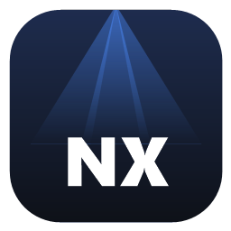
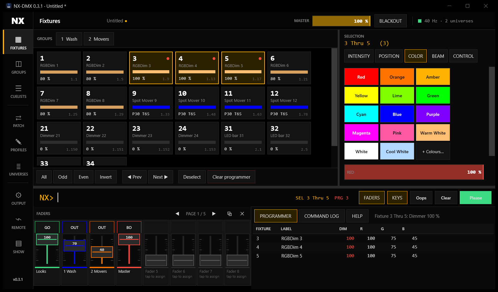
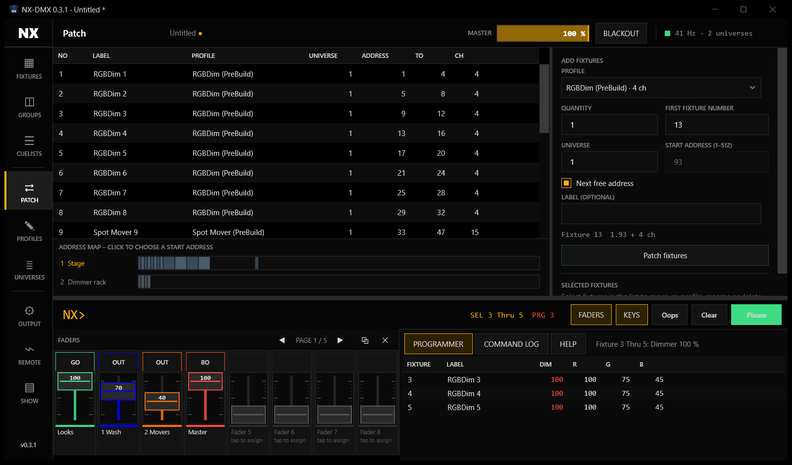
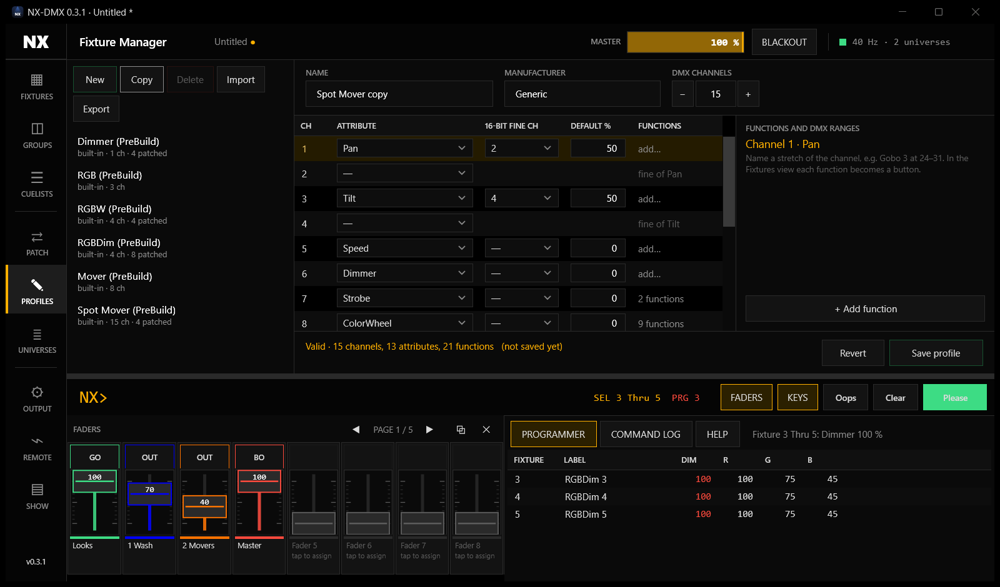
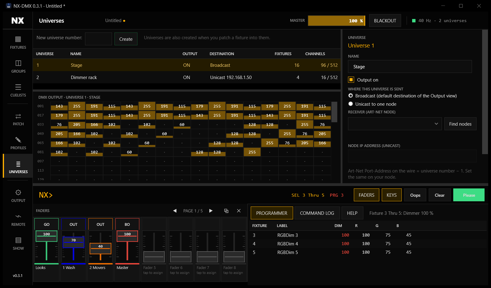

<div align="center">



# NX-DMX

**Lichtpult-Software für Windows mit Art-Net-Ausgabe: bedient mit Klicks und Befehlszeile wie bei ONYX und grandMA, ferngesteuert über Bitfocus Companion und Stream Deck.**

[](https://github.com/nexoGroups/NX-DMX/actions/workflows/ci.yml)
[](https://github.com/nexoGroups/NX-DMX/releases/latest)
[](LICENSE)


[**Download**](https://github.com/nexoGroups/NX-DMX/releases/latest/download/NxDmx-win-Setup.exe) ·
[Oberfläche](#die-oberfläche) ·
[Befehle](#befehle) ·
[Companion](#fernsteuerung-companion-stream-deck-osc) ·
[Art-Net](#art-net-einrichten) ·
[Roadmap](#roadmap)



</div>

---

## Was ist NX-DMX?

NX-DMX ist ein Lichtpult für Theater und Events, das als Windows-Programm läuft und DMX über **Art-Net** an Nodes im
Netzwerk schickt. Die Oberfläche folgt ONYX und grandMA: schwarz, flach und kantig, Farbe nur dort, wo sie etwas
bedeutet (Auswahl, Programmer, Wiedergabe, Fehler). Alles, was du anklickst, landet als Befehl in der Befehlszeile und im
Log, und alles, was du tippen kannst, kannst du auch von einem Stream-Deck-Knopf aus senden.

> **Stand: frühe Version (0.x).** Die Grundlagen funktionieren und sind getestet, aber es fehlt noch einiges, unter
> anderem Fades und Executor-Fader (siehe [Roadmap](#roadmap)). Die Art-Net-Ausgabe
> wurde bisher gegen einen Test-Empfänger geprüft, noch nicht an echter Hardware. Setze sie vorerst nicht für eine
> Live-Show ein, bei der etwas schiefgehen darf.

### Was schon geht

- **Linke Seitenleiste** mit allen Bereichen: Fixtures, Groups, Cuelists, Patch, Fixture Manager, Universes, Output,
  Remote, Show
- **Fixture-Ansicht** wie bei ONYX: jede gepatchte Fixture als Kachel mit Nummer, Name, Farbe, Pegel und Adresse. Klick
  wählt aus, `Strg`+Klick fügt hinzu oder nimmt weg, `Umschalt`+Klick wählt einen Bereich
- **Direkt klickbare Parameter:** Intensität, Position (Pan/Tilt-Feld), Farbe (Farbfelder und Regler), Beam und Control.
  Jeder Klick wird zum Befehl in der Befehlszeile und läuft sofort
- **Patch-Fenster:** Fixtures aus einem Profil in ein Universum auf eine Startadresse legen, verschieben, umbenennen, auf
  ein anderes Profil umstellen, löschen. Dazu eine Adresskarte aller Universen, Überschneidungen werden abgelehnt
- **Fixture Manager:** eigene Fixture-Profile mit Kanalanzahl, Belegung jedes Kanals, 16-Bit-Feinkanal, Standardwert und
  benannten **Funktionen mit DMX-Bereichen** (zum Beispiel „Gobo 3 = 24–31“). Import und Export als `.nxfixture`
- **Mehrere Universen**, jedes mit eigenem Namen, Ein/Aus und eigenem Ziel: Broadcast oder Unicast an einen Node
- **Befehlszeile und Tastenfeld** im Stil von grandMA2 und ONYX mit `Please` und `Oops`
- **Programmer-Tabelle** (rot = im Programmer gesetzt), Befehls-Log, Hilfe
- **Cuelists mit Tracking**, mehrere gleichzeitig, mit Go, Back, Off und Toggle je Cuelist
- **Master und Blackout** immer sichtbar in der Kopfzeile
- **Fader-Leiste** wie bei der grandMA3: acht Fader pro Seite (5 Seiten) für Cuelists, Gruppen-Submaster und den Master, jeder mit eigener Farbe. Fährst du über einen Fader, wird oben markiert, was darauf liegt. Die Leiste lässt sich in ein eigenes Fenster auslagern
- **Eigene Farben** anlegen, importieren und exportieren, helle Farbfelder mit schwarzer Schrift
- **Einstellungsseite** (Klick auf das NX): Start mit Windows (standardmäßig aus), Oberflächengröße für Touch-Bedienung und mehr
- **Art-Net-Empfänger pro Universum** wählbar, mit Suche nach Nodes im Netz (ArtPoll)
- **Fernsteuerung** per HTTP, OSC und Textport für Bitfocus Companion und Stream Deck
- **Art-Net 4** (ArtDmx, UDP Port 6454) mit 40 Hz, bis zu 32768 Universen
- **Shows speichern und laden** (`.nxshow`), dazu eine automatische Sicherung nach jeder Änderung
- **Automatische Updates:** Eine neue Version erscheint als grüner Button links unten (siehe [Updates](#updates))

## Installation

1. Lade **[NxDmx-win-Setup.exe](https://github.com/nexoGroups/NX-DMX/releases/latest/download/NxDmx-win-Setup.exe)** von der
   [Release-Seite](https://github.com/nexoGroups/NX-DMX/releases/latest) herunter.
2. Starte die Datei. Es ist keine Admin-Berechtigung nötig, und .NET muss nicht installiert sein. NX-DMX landet im
   Benutzerordner und bekommt eine Verknüpfung auf dem Desktop und im Startmenü.
3. Art-Net-Pakete gehen als ausgehender UDP-Verkehr raus, die Windows-Firewall lässt das normalerweise zu. Blockiert
   eine Sicherheitssoftware ausgehende Pakete, zeigt NX-DMX oben rechts einen Sendefehler an.

**Windows meldet "Der Computer wurde durch Windows geschützt"?** Das Installationsprogramm ist nicht mit einem
Zertifikat signiert, deshalb zeigt SmartScreen diese Warnung. Klicke auf **Weitere Informationen** und dann auf
**Trotzdem ausführen**. Den Quellcode, aus dem die Datei gebaut wird, findest du in diesem Repository, und die
Release-Dateien entstehen vollautomatisch in [GitHub Actions](.github/workflows/release.yml).

Voraussetzung: Windows 10 oder 11, 64 Bit.

## Die Oberfläche

Links wählst du den Bereich (`Strg+1` bis `Strg+9`), unten stehen immer Programmer-Tabelle bzw. Log, die Befehlszeile
und das Tastenfeld. Oben rechts siehst du Master, Blackout und den Zustand der Art-Net-Ausgabe.

| Bereich | Wofür |
|---|---|
| **Fixtures** | Fixtures auswählen und ihre Parameter direkt klicken: Intensität, Position, Farbe, Beam, Control |
| **Groups** | Gruppen als Kacheln: Klick wählt aus, **Record**, **Label** und **Delete** wirken auf eine angeklickte Gruppe |
| **Cuelists** | Cuelists als Playback-Karten mit **GO / BACK / OFF / TOGGLE**, darunter die Cues. Klick auf einen Cue springt dorthin |
| **Patch** | Fixtures hinzufügen, verschieben, umbenennen, löschen. Adresskarte aller Universen |
| **Fixture Manager** | Fixture-Profile bearbeiten: Kanäle, Attribute, 16 Bit, Standardwerte, Funktionen mit DMX-Bereichen |
| **Universes** | Universen anlegen und einzeln einstellen (Name, Ein/Aus, Broadcast oder Node-IP). Live-Anzeige der 512 Kanäle |
| **Output** | Netzwerkadapter, Standardziel, Senderate und was wohin gesendet wird |
| **Remote** | HTTP, OSC und Textport für Companion und Stream Deck |
| **Show** | Neu, Öffnen, Speichern, Sicherung |

<div align="center">

</div>

### Klicken ist Tippen

Wie bei ONYX wird jede Bedienung zu einem Befehl in der Befehlszeile. Ein Klick auf `Fixture 5`, auf ein Farbfeld oder
auf eine Funktion des Gobo-Rads schreibt `Fixture 5`, `Color Red` oder `Gobo Function "Gobo 2"` in die Zeile und führt
sie aus. Der Befehl steht im Log und lässt sich mit `Oops` zurücknehmen.

- Nach **Record**, **Update**, **Delete** oder **Label** vervollständigt der nächste Klick auf eine Gruppe, einen Cue
  oder eine Cuelist den Befehl und führt ihn aus (bei **Label** tippst du danach den Namen in Anführungszeichen).
- Steht schon etwas in der Befehlszeile, hängt ein Klick seinen Befehl nur an. Mit **Please** schickst du ihn ab.
- Tippen funktioniert überall: Buchstaben, die du eingibst, landen in der Befehlszeile, auch nach einem Klick.

## Schnellstart

Beim allerersten Start ist ein Demo-Rig gepatcht (8 RGB-Dimmer-Fixtures, 4 Moving Heads, 4 Dimmer, zwei Gruppen).
Danach startet NX-DMX immer mit der Show der letzten Sitzung.

1. In **Fixtures** auf die Gruppe **Wash** klicken. Im Bereich **COLOR** auf **Warm White** und im Bereich **INTENSITY**
   auf **80** klicken.
2. In **Cuelists** auf **Record Cue** klicken, dann **GO** drücken.
3. Mit **Oops** den letzten Schritt zurücknehmen.

Dasselbe als Befehle in die Zeile `NX>` getippt:

```text
NX> Group 1                        Gruppe 1 auswählen
NX> Color "Warm White"             Warmweiß auf alle Farb-Emitter
NX> At 80                          Intensität 80 %
NX> Record Cue 1 "Warm Wash"       Alles aus dem Programmer als Cue 1 speichern
NX> ClearAll                       Programmer leeren
NX> Go                             Cue 1 starten
NX> Oops                           Den letzten Programmierschritt zurücknehmen
```

Mit `Help` (oder dem Reiter HELP unten) listet die Software alle Befehle auf.

## Befehle

| Befehl | Wirkung |
|---|---|
| `Fixture 1 Thru 10` | Fixtures 1 bis 10 auswählen |
| `Fixture 1 + 5 + 7 Thru 9 - 8` | Mit `+` hinzufügen und mit `-` entfernen |
| `Group 2` | Gruppe 2 auswählen |
| `At 50` oder `At Full` oder `Full` | Intensität der Auswahl in Prozent |
| `Red At 100`, `Pan At 25 Tilt At 70` | Einzelne Attribute, auch mehrere hintereinander |
| `Gobo Function "Gobo 2"` | Eine benannte Funktion des Kanals (aus dem Fixture-Profil) |
| `Color Red`, `Color "Warm White"` | Alle Farb-Emitter der Auswahl: RGB, Weiß, Amber, CMY und Farbrad |
| `Record Cue 1 "Name"` | Programmer als Cue speichern, optional mit `Cuelist 2` |
| `Record Group 3 "Name"` | Auswahl als Gruppe speichern |
| `Update Cue 1` | Den Programmer in einen bestehenden Cue einfügen |
| `Delete Cue 1`, `Delete Group 3`, `Delete Cuelist 2` | Löschen |
| `Delete Fixture 1 Thru 5`, `Delete Universe 3` | Aus dem Patch entfernen (ein Universum nur, wenn es leer ist) |
| `Label Group 3 "Front"` | Umbenennen (auch `Cue`, `Cuelist`, `Fixture` und `Universe`) |
| `Go`, `Go -`, `Back`, `Goto Cue 5`, `Off`, `Toggle` | Playback, mit `Cuelist 2` hinten für eine andere Cuelist |
| `Blackout`, `Blackout On`, `Blackout Off` | Alle Intensitäten aus (ohne `On`/`Off` wechselt es) |
| `Master At 80` | Grand Master in Prozent |
| `Color #FF8800` | Eine Farbe als Hex-Wert, ohne sie zu speichern |
| `Fader 3 At 60` | Fader 3 bewegen (Cuelist: ab 1 % Go, bei 0 Off. Gruppe: Submaster. Master: Grand Master) |
| `Fader 3 Button` | Die Taste über dem Fader (Cuelist: nächster Cue, Gruppe: aus/voll, Master: Blackout) |
| `Fader 3 Cuelist 2`, `Fader 3 Group 1`, `Fader 3 Master`, `Fader 3 Clear` | Belegung eines Faders |
| `Fader 3 Label "Front"`, `Fader 3 Color #FF8800` | Name und Farbe eines Faders (`Color Default` setzt die Standardfarbe zurück) |
| `Patch Fixture 1 Thru 8 Type RGBDim At 1.1` | Fixtures anlegen: Profil und Adresse als `Universum.Adresse` |
| `Patch Fixture 5 At 2.1` | Vorhandene Fixture verschieben (ohne `Type`) |
| `Patch Fixture 5 Type RGB` | Profil einer vorhandenen Fixture ändern (ohne `At`) |
| `Universe 2 Label "FOH" Unicast 10.0.0.5 On` | Universum anlegen oder ändern. `Broadcast` und `Off` gibt es auch |
| `Clear` | Schrittweise zurück: erst Auswahl, dann Programmer |
| `ClearAll` | Auswahl und Programmer auf einmal leeren |
| `Oops` | Letzten Programmierschritt zurücknehmen, bis zu 100 Mal |
| `Please` | Führt die Zeile aus. Am Zeilenende optional, wie bei der grandMA |
| `Help` | Zeigt die Befehlsübersicht |

Mehrere Befehle lassen sich mit `;` hintereinander setzen, zum Beispiel `Group 2; Color Blue; At 80`. Sie laufen der
Reihe nach und halten beim ersten Fehler an.

**Profile:** `Dimmer` (1 Kanal), `RGB` (3), `RGBW` (4), `RGBDim` (4, mit Dimmer-Kanal), `Mover` (8, Pan/Tilt in 16 Bit,
Dimmer, RGB) und `Spot Mover` (15: Pan/Tilt 16 Bit, Dimmer, Strobe, Farbrad, Gobo, Prisma, Fokus, Zoom und mehr mit
benannten Funktionen) sind eingebaut, eigene baust du im Fixture Manager. RGB-Fixtures ohne eigenen Dimmer bekommen einen
virtuellen Dimmer, der die Farben skaliert.

**Oops und Playback:** `Oops` macht alle Programmierschritte rückgängig (Auswahl, Werte, Record, Delete, Label, Patch,
Universen, Fixture-Profile). `Go`, `Back`, `Goto`, `Off`, `Toggle`, `Blackout` und `Master` gehören nicht dazu, wie bei der
grandMA. Ein fehlgeschlagener Befehl hinterlässt nichts Halbfertiges.

## Fixtures patchen

Im Bereich **Patch** wählst du ein Profil, die Anzahl, die erste Fixture-Nummer, das Universum und die Startadresse. Bei
**Next free address** sucht NX-DMX die erste freie Stelle im Universum. Ein Klick auf die Adresskarte übernimmt Universum
und Kanal. Hinter dem Knopf steckt ein normaler Befehl, zum Beispiel
`Patch Fixture 1 Thru 8 Type RGBDim At 1.1 Label "Wash"`.

- Füllt sich ein Universum, geht es im nächsten weiter.
- **Überschneidungen werden abgelehnt**, mit dem Hinweis, welche Fixture im Weg ist.
- In der Liste ausgewählte Fixtures kannst du verschieben, auf ein anderes Profil umstellen, umbenennen und löschen.

## Fixture Manager

Der Bereich **Profiles** ist ein eigener Editor für Fixture-Profile:

- **DMX Channels:** wie viele Kanäle die Fixture belegt (auch ungenutzte).
- Pro Kanal das **Attribut** (Dimmer, Rot, Grün, Blau, Weiß, Amber, UV, CMY, Farbrad, Pan, Tilt, Zoom, Fokus, Iris, Frost,
  Prisma, Gobo, Gobo-Rotation, Strobe, Speed, Control, Custom), optional ein **16-Bit-Feinkanal** und der **Standardwert**.
- Pro Kanal **Funktionen mit DMX-Bereichen** von 0 bis 255, etwa „Open 0–7“, „Gobo 1 8–15“. In der Fixture-Ansicht wird
  jede Funktion zu einem Knopf.
- Eingebaute Profile tragen den Zusatz **(PreBuild)** und sind schreibgeschützt: mit **Copy** machst du eine bearbeitbare Kopie. Ungültige Eingaben (doppelte
  Kanäle, überlappende Bereiche, Zahlen außerhalb von 0–255) werden live gemeldet und lassen sich nicht speichern.
- Profile liegen in der Show und reisen mit ihr. Mit **Export** und **Import** teilst du sie als `.nxfixture`-Datei.
- Ändert man ein Profil, folgen alle gepatchten Fixtures davon sofort. Passt es dann nicht mehr ins Universum, wird die
  Änderung abgelehnt.

<div align="center">

</div>

## Universen

Im Bereich **Universes** legst du beliebig viele Universen an. Jedes hat seine eigenen Einstellungen:

| Einstellung | Bedeutung |
|---|---|
| **Name** | Zum Beispiel „Bühne“ oder „Dimmerrack“ |
| **Output on** | Schaltet nur dieses Universum ab, die anderen laufen weiter |
| **Broadcast** | Das Universum geht an das Standardziel aus dem Bereich Output |
| **Unicast** | Das Universum geht direkt an einen Node (IPv4-Adresse). Mit **Find nodes** fragt NX-DMX das Netz nach Art-Net-Nodes (ArtPoll) und du wählst den Empfänger aus der Liste. Jedes Universum kann einen anderen haben |

Universen entstehen auch automatisch, wenn du eine Fixture hineinpatchst. Ein Universum mit gepatchten Fixtures lässt sich
nicht löschen. Darunter zeigt die Live-Anzeige alle 512 Kanäle des ausgewählten Universums.

<div align="center">

</div>

## Fernsteuerung: Companion, Stream Deck, OSC

NX-DMX lässt sich vollständig von **Bitfocus Companion** und damit von jedem Stream Deck bedienen. Weil jede Anfrage ein
normaler Konsolenbefehl ist, kannst du alles auf einen Knopf legen, was du tippen kannst. Im Bereich **Remote** schaltest
du die Schnittstellen ein und findest fertige Beispiele zum Kopieren.

| Schnittstelle | Standard | Verwendung |
|---|---|---|
| **HTTP** | Port 8765 | Companion-Modul „Generic: HTTP Requests“, z. B. `GET /api/go/1` |
| **OSC (UDP)** | Port 8000 | Companion-Modul „Generic: OSC“, z. B. `/nxdmx/go 1` |
| **Text (TCP und UDP)** | Port 7000 | „Generic: TCP/UDP“: eine Zeile pro Befehl, Antwort `OK …` oder `ERR …` |

Standardmäßig hören alle Schnittstellen nur auf **diesem Computer**. Soll Companion auf einem anderen Rechner laufen, schaltest
du **Allow other computers** ein. HTTP kann zusätzlich mit einem Token geschützt werden, und Anfragen von Webseiten im
Browser lehnt NX-DMX ab. Eine Schritt-für-Schritt-Anleitung mit Beispielknöpfen steht in
[docs/companion.md](docs/companion.md).

## Fader-Leiste

Der Knopf **FADERS** neben der Befehlszeile blendet unten links die Fader-Leiste ein, in der gleichen Größe wie das Tastenfeld.
Die Befehlszeile wandert dann nach oben über Fader-Leiste, Programmer-Tabelle und Tastenfeld.

- **Acht Fader pro Seite**, fünf Seiten (Pfeile oben in der Leiste). Über jedem Fader sitzt eine Taste, darunter steht der Name
  auf einem Streifen in der Farbe des Faders.
- **Belegung:** Tippe auf den Namen eines Faders (oder klicke mit der rechten Maustaste auf den Fader). Er kann eine **Cuelist** steuern
  (ab 1 % startet sie, bei 0 wird sie ausgeschaltet, dazwischen skaliert der Fader ihre Intensität), eine **Gruppe** als Submaster
  (skaliert die Intensität ihrer Fixtures) oder den **Master**. Name und Farbe wählst du im selben Fenster.
- **Highlight:** Fährst du mit der Maus über einen Fader, markiert NX-DMX blau, was darauf liegt: die Fixtures der Gruppe oder
  der Cuelist in der Fixture-Ansicht, die Kachel in Groups, die Karte in Cuelists. In der Kopfzeile steht der Name.
- **Eigenes Fenster:** Mit dem Symbol oben rechts in der Leiste (⧉) öffnest du die Leiste in einem eigenen Fenster, etwa auf
  einem zweiten oder Touch-Bildschirm. Das Symbol im Fenster (⮌) oder das Schließen holt sie zurück.
- Fader sind Befehle: `Fader 3 At 60`, `Fader 3 Cuelist 2` und die anderen stehen in der [Befehlsliste](#befehle) und gehen auch
  über Companion (`/api/fader/3/60`, OSC `/nxdmx/fader 3 60`).
- Die Belegung wird mit der Show gespeichert, die Stellung der Fader nicht.

## Eigene Farben

Auf der Seite **COLOR** der Fixture-Ansicht öffnet **+ Colours…** die Farbbibliothek: Name und Hex-Wert eingeben oder mit
drei Reglern mischen und hinzufügen. Eigene Farben tragen einen gelben Rand, funktionieren wie `Color <Name>` und liegen in der
Show. Mit **Import** lädst du eine Liste (`.nxcolors` oder Text mit einer Farbe pro Zeile, `Name;#RRGGBB`), mit **Export** gibst
du deine Farben weiter. Eine Farbe mit dem Namen einer eingebauten Farbe ersetzt diese. Die Schrift auf den Farbfeldern ist auf
hellen Farben schwarz und auf dunklen weiß.

## Einstellungen und Touch

Ein Klick auf das **NX** oben links öffnet die Einstellungen (`Strg+0`):

| Einstellung | Wirkung |
|---|---|
| **Start NX-DMX when Windows starts** | Startet das Programm beim Anmelden in Windows. Standardmäßig **aus** |
| Look for a new version | Suche nach Updates beim Start |
| Open the view that was open last time | Beim Start in der zuletzt benutzten Ansicht |
| **Interface** 100 bis 200 % | Skaliert die ganze Oberfläche, größere Knöpfe für Touch-Bildschirme |
| Show the keypad / the fader bar | Tastenfeld und Fader-Leiste ein- oder ausblenden |
| Ask before deleting | Rückfrage vor dem Löschen von Fixtures, Universen und Profilen |

Knöpfe, Eingabefelder, Listenzeilen und Rollbalken haben Fingergröße, Listen sind zum Verschieben mit dem Finger eingerichtet, und der
Touch-Druck läuft ohne die Windows-Wartezeit für Rechtsklick und Wischgesten. Das ist an einem echten Touch-Bildschirm noch nicht getestet. Bei hohen Skalierungen blendet NX-DMX das Tastenfeld selbst aus, wenn der Platz
fehlt (die Taste **KEYS** bringt es zurück, sobald das Fenster breit genug ist).

## Shows speichern und laden

Eine Show besteht aus den Universen, den eigenen Fixture-Profilen, dem Patch, den Gruppen und den Cuelists mit allen Cues.
Der Bereich **Show** und die Kopfzeile zeigen den Namen, und ein oranges **●** erscheint, solange es ungespeicherte
Änderungen gibt.

| Taste | Tastenkürzel | Wirkung |
|---|---|---|
| **New** | `Strg+N` | Leere Show anlegen |
| **Open** | `Strg+O` | Eine `.nxshow`-Datei öffnen |
| **Save** | `Strg+S` | Speichern, beim ersten Mal mit Namensabfrage |
| **Save as** | `Strg+Umschalt+S` | Unter neuem Namen speichern |

- Die Dateien liegen standardmäßig in `Dokumente\NX-DMX Shows` und sind lesbares JSON. Sie lassen sich kopieren, sichern
  und auf einen anderen Rechner mitnehmen. Dateien im alten Format (aus 0.2) lassen sich weiter öffnen.
- **Automatische Sicherung:** Nach jeder Änderung schreibt NX-DMX die aktuelle Show nach `%AppData%\NX-DMX`. Nach einem
  Absturz, einem Stromausfall oder einem Update-Neustart ist sie beim nächsten Start wieder da.
- Vor **New**, **Open** und dem Schließen fragt NX-DMX nach, wenn es ungespeicherte Änderungen gibt.
- Nicht gespeichert werden der Programmer, die Auswahl, die Cue-Position der Cuelists, Blackout, Master und die
  Netzwerkeinstellungen dieses Computers. Nach dem Laden ist alles aus.
- Eine kaputte oder zu neue Datei wird mit einer Meldung abgelehnt und lässt die aktuelle Show unverändert.
- Unerwartete Fehler zeigen eine Meldung, schreiben `error.log` in den Datenordner und lassen das Pult weiterlaufen.

## Art-Net einrichten

Im Bereich **Output** stellst du die Ausgabe ein:

| Feld | Bedeutung |
|---|---|
| **Send DMX** | Schaltet die gesamte Ausgabe ab, ohne die Programmierung zu verlieren |
| **Network adapter** | Hast du mehrere Netzwerkadapter (WLAN, LAN, VPN), wähle den, an dem die Nodes hängen. Sonst schickt Windows den Broadcast über irgendeinen davon. |
| **Default destination** | Standard ist der Broadcast `255.255.255.255`. Für alle Universen, die auf **Broadcast** stehen. Knöpfe für `2.255.255.255`, `10.255.255.255` und den Broadcast des gewählten Adapters |

Mit **Apply** übernimmst du die Einstellung. In der Kopfzeile stehen die tatsächliche Senderate und die Zahl der Universen.
Einzelne Universen können in **Universes** an eine feste Node-IP gehen, unabhängig vom Standardziel. Fällt ein Node aus,
laufen die übrigen Universen weiter.

- Dein PC und der Node müssen im selben Netz liegen, bei Art-Net meist `2.x.x.x` (255.0.0.0) oder `10.x.x.x`.
- NX-DMX zählt Universen **ab 1**. **Universum 1 wird als Port-Address 0** im Paket gesendet, also Net 0, Sub-Net 0,
  Universum 0. Die meisten Nodes zählen ab 0, dann stellst du den Ausgang des Nodes auf 0.
- Gesendet werden alle angelegten Universen mit **40 Hz**. Das Art-Net-Maximum liegt bei 44 Hz.

## Updates

NX-DMX prüft beim Start im Hintergrund, ob es auf GitHub ein neueres Release gibt. Wenn ja, erscheint links unten ein
grüner Button **Update x.y.z**. Ein Klick lädt die neue Version herunter und fragt, ob jetzt neu gestartet werden
soll oder erst beim nächsten Beenden.

- Das Pult **startet niemals von allein neu**, weil gerade eine Show laufen könnte.
- Ohne Internet passiert nichts, und es gibt keine Fehlermeldung.
- Mit einem Klick auf die Versionsnummer (`v0.3.1`) links unten suchst du von Hand nach Updates.
- Updates funktionieren in der **installierten** Version. Eine aus dem Quellcode gestartete Version meldet das im Log.
- Deine Show bleibt beim Neustart erhalten, weil sie automatisch gesichert wird (siehe [Shows speichern](#shows-speichern-und-laden)).
  Der Programmer und die Cuelist-Positionen starten danach leer. Der Dialog weist darauf hin.

Technisch steckt [Velopack](https://velopack.io) dahinter: Der Installer und die Update-Pakete liegen als Dateien am
GitHub-Release, und wo möglich werden nur die Unterschiede (Delta-Pakete) geladen.

## Aus dem Quellcode starten

Du brauchst das [.NET 10 SDK](https://dotnet.microsoft.com/download/dotnet/10.0).

```powershell
git clone https://github.com/nexoGroups/NX-DMX.git
cd NX-DMX

dotnet run --project src/NxDmx.App     # Programm starten
dotnet test                            # Tests ausführen
```

Hinweis: Eine frisch installierte .NET-SDK kennt ein bereits offenes Terminal noch nicht. Öffne es dann neu.

Mit der Umgebungsvariable `NXDMX_DATA` legst du einen anderen Datenordner für Sicherung und Einstellungen fest, etwa zum
Ausprobieren, ohne die eigene Show anzufassen.

## Projektaufbau

| Ordner | Inhalt |
|---|---|
| `src/NxDmx.Core` | Alles ohne Oberfläche: Art-Net, Fixtures, Profile und Patch, Universen, Programmer, Cuelists, Befehlsinterpreter, Renderer, Ausgabe-Engine, Fernsteuerung (HTTP, OSC, Text) |
| `src/NxDmx.App` | WPF-Oberfläche: Theme, Hauptfenster, Ansichten (`Views/`), eigene Steuerelemente (`Controls/`), Dienste (`Services/`) |
| `tests/NxDmx.Tests` | xUnit-Tests für Art-Net-Pakete, Befehle, Patch, Profile, Universen, Rendering, Oops, Showdateien, Engine und Fernsteuerung |
| `tools/` | Skripte für Icon, Screenshots, das Paketieren eines Releases und den Update-Test |
| `docs/` | Companion-Anleitung, Bilder, Release-Notizen |
| `.claude/skills/release` | Anleitung für Claude Code, wie eine neue Version veröffentlicht wird |

So läuft ein Frame (40 Hz): `Programmer` und aktive `Cuelist`s → `FrameRenderer` (mit Master und Blackout) → `DmxFrame` →
`ArtNetOutput` (ArtDmx per UDP, pro Universum an Broadcast oder Node). Die Cues arbeiten mit Tracking: Der Ausgang entsteht
aus allen Cues bis zum aktuellen, der Reihe nach angewendet. Jede Bedienung, auch Klicks und Fernsteuerung, läuft durch
denselben `CommandInterpreter`.

## Ein Release veröffentlichen

Für Maintainer: Version im Tag festlegen und pushen. Den Rest erledigt [GitHub Actions](.github/workflows/release.yml).

```powershell
git tag v0.3.0
git push origin v0.3.0
```

Der Workflow führt die Tests aus, baut die selbstständige Windows-Version, erzeugt mit Velopack den Installer, das
Update-Paket und den Update-Feed und veröffentlicht alles als GitHub-Release. Danach sehen installierte Programme das
Update. Lokal erzeugt `tools/pack.ps1 -Version 0.3.0` dieselben Dateien im Ordner `Releases/`. Dazu brauchst du das
Velopack-Werkzeug in der passenden Version: `dotnet tool install -g vpk --version 1.2.161`.

Zum Testen eines Updates vor der Veröffentlichung kannst du die Umgebungsvariable `NXDMX_UPDATE_SOURCE` auf einen
Ordner (oder eine URL) mit den Release-Dateien setzen, dann sucht die installierte Version dort statt auf GitHub.

## Roadmap

- [ ] Fade- und Delay-Zeiten
- [x] Shows speichern und laden, automatische Sicherung
- [x] Patch-Fenster, Fixture-Manager, mehrere Universen
- [x] Fernsteuerung für Companion, Stream Deck und OSC
- [ ] Presets (Color, Position, Beam) als eigene Objekte
- [ ] Executor-Fader und Seiten
- [ ] Copy und Move, Highlight und Locate
- [ ] GDTF-Import
- [ ] Effekte
- [ ] Art-Net-Node-Erkennung (ArtPoll), sACN
- [ ] Signierter Installer

Ideen und Fehler gern als [Issue](https://github.com/nexoGroups/NX-DMX/issues) melden.

## Lizenz

[MIT](LICENSE) © 2026 Cameron Wieland
